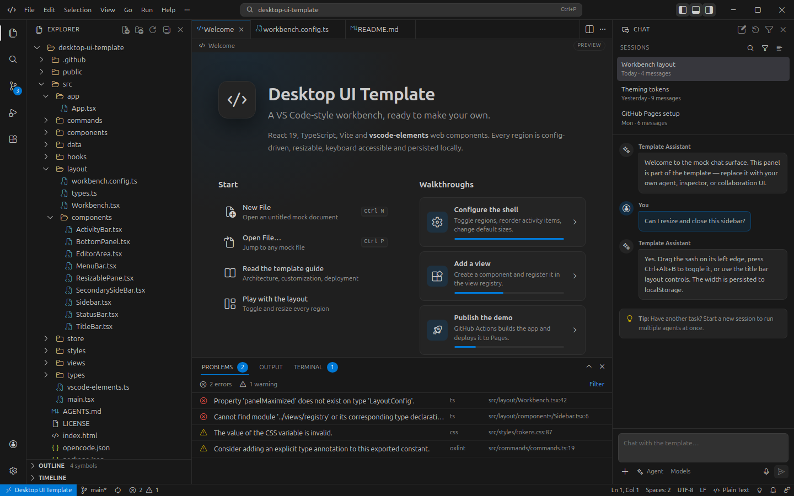

# Desktop UI Template

A configurable, VS Code-style desktop UI shell for the web. Built with **React 19**, **TypeScript**, **Vite 8**, **Zustand** and the [**vscode-elements**](https://github.com/vscode-elements/elements) web components.

[](https://github.com/mode777/desktop-ui-template/actions/workflows/ci.yml)
[](https://github.com/mode777/desktop-ui-template/actions/workflows/deploy-pages.yml)
[](LICENSE)

**[Open the live demo →](https://mode777.github.io/desktop-ui-template/)**



## What this is

A production-minded starting point for tools that need a desktop-class workbench: IDEs, admin consoles, creative tools, data explorers, internal developer platforms, or any application that wants VS Code's layout language without adopting VS Code itself.

The shell is real. The documents are deliberate mock previews.

- A **title bar** with menus, command center, layout controls and window controls.
- An **activity bar** with badge support and runtime view switching.
- A **primary sidebar** with Explorer, Search, Source Control, Run and Extensions views.
- A **secondary sidebar** with a working chat mock, resizable and collapsible.
- An **editor area** with open/close/activate/reorder tabs, drag reorder, middle-click close, a tab context menu and static document previews.
- A **bottom panel** with Problems, Output and an interactive terminal mock.
- A **status bar** with workspace, Git, problems, cursor, encoding and language indicators.
- **Persisted layout**: region visibility, sash sizes, open tabs, active views and theme survive reloads.
- **Keyboard-first navigation**: quick open, command palette, view toggles and region shortcuts.
- **Dark and light themes** driven entirely by CSS custom properties.

## Quick start

```bash
npm install
npm run dev
```

Open <http://localhost:5173>.

```bash
npm run check       # lint + format check + typecheck + tests + production build
npm run lint        # oxlint
npm run typecheck   # tsc -b
npm run test        # vitest
npm run build       # production build in dist/
npm run preview     # serve the production build
```

Requires Node 24 (see `.nvmrc`). The template uses Vite 8 and TypeScript 7.

## Layout architecture

```text
┌──────────────────────────────────────────────────────────────┐
│ title bar: menu · command center · layout + window controls  │
├──────┬──────────────┬──────────────────────────┬─────────────┤
│      │              │ editor tabs              │             │
│activity              ├──────────────────────────┤ secondary   │
│ bar  │ primary      │ editor / document        │ sidebar     │
│      │ sidebar      ├──────────────────────────┤ (chat)      │
│      │              │ bottom panel             │             │
├──────┴──────────────┴──────────────────────────┴─────────────┤
│ status bar                                                   │
└──────────────────────────────────────────────────────────────┘
```

Every region is independently removable. The layout is a small flex composition rather than a rigid grid, so hiding a region lets the remaining surfaces reclaim the space.

```text
src/
  app/App.tsx                 theme application + root
  layout/
    Workbench.tsx             composes all regions
    workbench.config.ts       ← the main customization surface
    types.ts                  config and view contracts
    components/
      TitleBar.tsx            frame, command center, window controls
      MenuBar.tsx             File/Edit/Selection/View/Go/Run/Help
      ActivityBar.tsx         navigation rail
      Sidebar.tsx             primary sidebar container
      SecondarySideBar.tsx    secondary sidebar container
      EditorArea.tsx          tab strip, breadcrumbs, document host
      BottomPanel.tsx         Problems / Output / Terminal tabs
      StatusBar.tsx           workspace + document indicators
      ResizablePane.tsx       accessible sash with keyboard support
      QuickOpen.tsx           Ctrl+P / Ctrl+Shift+P dialog
      Notifications.tsx       toast surface
  commands/
    commands.ts               command registry (single source of truth)
    menus.ts                  menu definitions referencing command IDs
  views/
    registry.tsx              primary / secondary / panel view registry
    ExplorerView.tsx ...      replaceable view surfaces
  store/
    workbench-store.ts        Zustand store + localStorage persistence
  styles/
    tokens.css                VS Code color tokens (dark + light)
    global.css                reset and shared primitives
    workbench.css             shell and view styling
  data/workspace.ts           mock file tree, documents and metadata
  vscode-elements.ts          registers only the used web components
  types/vscode-elements.d.ts  JSX typings for the custom elements
```

## Customize the shell

### Remove or reorder regions

Edit `src/layout/workbench.config.ts`:

```ts
export const workbenchConfig: WorkbenchConfig = {
  titleBar: { enabled: true, menuBar: true /* … */ },
  activityBar: {
    enabled: true,
    items: [
      { id: 'explorer', title: 'Explorer', icon: 'files' },
      // remove an item to remove it from the rail
    ],
  },
  primarySideBar: {
    enabled: true,
    initialWidth: 300,
    minWidth: 180,
    maxWidth: 640,
    views: ['explorer', 'search', 'source-control', 'run', 'extensions'],
  },
  // secondarySideBar, bottomPanel, statusBar …
}
```

Set `enabled: false` to remove a region completely. Users can also hide regions at runtime with the View menu, the title bar layout controls, or the shortcuts below. Runtime visibility and sash sizes are persisted separately from the config.

### Add a sidebar view

1. Create a component in `src/views`, e.g. `InspectorView.tsx`.
2. Register it in `src/views/registry.tsx`:

```tsx
export const primaryViews = {
  // …
  inspector: {
    id: 'inspector',
    title: 'Inspector',
    icon: 'symbol-property',
    component: InspectorView,
    actions: [{ icon: 'refresh', label: 'Refresh', commandId: 'inspector.refresh' }],
  },
}
```

3. Add `'inspector'` to `PrimaryViewId`, the activity bar items, and `primarySideBar.views`.
4. Optionally add the matching command in `src/commands/commands.ts`.

### Add a command

Append an entry to `commandList`. Menus and the command palette read from the same registry, so one entry is enough:

```ts
{
  id: 'inspector.open',
  title: 'Open Inspector',
  category: 'View',
  keybinding: 'Ctrl+Alt+I',
  run: () => useWorkbenchStore.getState().showPrimaryView('inspector'),
}
```

### Replace the document surface

The editor is intentionally a static preview. Swap `src/views/DocumentView.tsx` for Monaco, CodeMirror, an iframe, or your own renderer. Tabs, breadcrumbs, dirty indicators and the status bar are already wired for it.

### Theme

All colors live in `src/styles/tokens.css` as VS Code-compatible custom properties. `src/app/App.tsx` writes `data-theme="dark|light"` to `<html>`, and every component, including the vscode-elements shadow DOM, inherits the tokens. Add a new theme by adding another `[data-theme='…']` block.

## Keyboard shortcuts

| Shortcut                       | Action                             |
| ------------------------------ | ---------------------------------- |
| `Ctrl+B` / `Cmd+B`             | Toggle primary sidebar             |
| `Ctrl+Alt+B` / `Cmd+Option+B`  | Toggle secondary sidebar           |
| `Ctrl+J` / `Cmd+J`             | Toggle bottom panel                |
| `Ctrl+P` / `Cmd+P`             | Quick open files                   |
| `Ctrl+Shift+P` / `Cmd+Shift+P` | Command palette                    |
| `Ctrl+Shift+E`                 | Explorer                           |
| `Ctrl+Shift+F`                 | Search                             |
| `Ctrl+Shift+G`                 | Source control                     |
| `Ctrl+Shift+D`                 | Run and Debug                      |
| `Ctrl+Shift+X`                 | Extensions                         |
| `Ctrl+Shift+M`                 | Problems                           |
| `Ctrl+\``                      | Toggle terminal                    |
| `Ctrl+W`                       | Close active editor                |
| `Ctrl+Shift+W`                 | Close all editors                  |
| `Ctrl+Tab`                     | Cycle editors                      |
| `Ctrl+S`                       | Save (clears the mock dirty state) |
| `F5` / `Shift+F5`              | Start / stop mock debugging        |

Sashes are keyboard accessible too: focus a divider and use arrow keys, `Shift` for larger steps, `Home`/`End` for the limits, and double-click to reset.

## Tech stack

| Area          | Choice                                                              |
| ------------- | ------------------------------------------------------------------- |
| UI            | React 19 with the modern JSX transform                              |
| Build         | Vite 8 (Rolldown)                                                   |
| Language      | TypeScript 7, strict + `erasableSyntaxOnly`                         |
| Controls      | [vscode-elements](https://vscode-elements.github.io) 2.5 + Codicons |
| State         | Zustand 5 with `persist` middleware                                 |
| Tests         | Vitest 5 + jsdom + Testing Library                                  |
| Lint / format | oxlint + Prettier                                                   |
| Deploy        | GitHub Actions → GitHub Pages                                       |

vscode-elements is a Lit-based web-component library. React 19 renders the custom elements directly; local JSX typings live in `src/types/vscode-elements.d.ts`. The Codicon stylesheet is served from `public/codicons` and synced from `@vscode/codicons` by `scripts/sync-codicons.mjs` before `dev` and `build` (the `id="vscode-codicon-stylesheet"` link is required for shadow-DOM font loading).

## Roadmap

The next step is to make the workbench reusable at three levels — full preset, composed regions and individual primitives — without losing the copyable template. The staged plan, package boundaries, tree-shaking rules and acceptance criteria are in [ROADMAP.md](ROADMAP.md).

## Working with OpenCode

The repository is initialized for [OpenCode](https://opencode.ai) with `opencode.json` and a project-specific [`AGENTS.md`](AGENTS.md). The agent guide documents the architecture rules, commands, styling conventions and non-goals so automated changes stay consistent with the template.

## Deployment

The `Deploy to GitHub Pages` workflow runs on every push to `main` and on manual dispatch:

1. `npm ci`
2. `npm run build`
3. `configure-pages` + `upload-pages-artifact`
4. `deploy-pages`

Vite uses `base: './'`, so the same `dist/` works at the repository root on Pages, under a subdirectory, or inside an iframe. Enable Pages once under **Settings → Pages → Build and deployment → GitHub Actions** (or with `gh api`).

The CI workflow runs lint, formatting, typecheck, tests and build on every push and pull request.

## Non-goals

- No real code editor or language services. The document area is a preview.
- No real file system, Git backend or agent runtime. The Explorer, Source Control and Chat surfaces are mocks designed to be replaced.
- No dependency on VS Code, Electron or Theia. This is a browser UI template.

## License

[MIT](LICENSE). The included vscode-elements and Codicons packages retain their own licenses (MIT and CC-BY-4.0 respectively).
