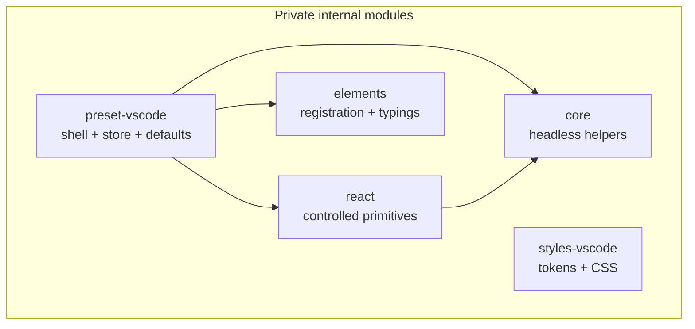

# Workbench Kit architecture

This document is the canonical description of how the workbench is split, what
each part may contain and how the result is distributed. It complements
[`ROADMAP.md`](../ROADMAP.md), which owns sequencing and exit criteria, and
[`boundaries.json`](../boundaries.json) plus [`distribution.json`](../distribution.json),
which make the mechanical parts enforceable.

**Decision in one sentence:** the kit has **five private internal modules** and
**one published npm package**. The modules keep the architecture boundaries; the
public package exposes them through subpath exports.

## 1. The product boundary

The workbench is the shell, not the application built inside it.

- **Kit:** regions, layout, tabs, resizing, persistence, generic commands,
  element registration and reusable styling. It knows about regions, not about
  Explorer, Chat or Terminal.
- **App/demo:** views, mock or real data, menus, product commands, branding,
  document rendering, status-bar content, routes and configuration. It consumes
  the kit through public entry points.

The preset may ship defaults for generic workbench behavior. It must not ship
product policy. A quick test: _would a consumer in a different domain want this
unchanged?_ If yes, it may belong in the kit. If they would want the shape but
not the content, split it — a generic primitive in the kit and the domain view in
the app.

## 2. Five internal modules

The repository is an npm workspace. These five directories are **internal
modules**, not five published packages:

| Module                         | Path                     | Owns                                                                                        | May import                  | Must not contain                                                  |
| ------------------------------ | ------------------------ | ------------------------------------------------------------------------------------------- | --------------------------- | ----------------------------------------------------------------- |
| `@workbench-kit/core`          | `packages/core`          | Layout math, tab collection transitions, resize helpers, versioned storage adapters         | Its own modules             | React, DOM globals, app data, vscode-elements                     |
| `@workbench-kit/react`         | `packages/react`         | `WorkbenchShell`, `ResizablePane`, `TabStrip`, `IconButton` and other controlled primitives | `core`, React               | Demo views, workspace data, command registries, preset state      |
| `@workbench-kit/elements`      | `packages/elements`      | Per-tag vscode-elements registration entries and JSX typings                                | vscode-elements             | App UI, data, workbench behavior                                  |
| `@workbench-kit/styles-vscode` | `packages/styles-vscode` | Tokens, base CSS, per-component stylesheets, aggregate stylesheet                           | Its own CSS                 | Demo-view selectors, palette values outside tokens                |
| `@workbench-kit/preset-vscode` | `packages/preset-vscode` | `VSCodeWorkbench`, regions, default store, generic commands, preset element registration    | `core`, `react`, `elements` | App/demo modules, app data, menus, branding, implicit CSS imports |

All five declare `"private": true`. They are never published individually.
Adding a sixth internal module is an architecture change: update
[`boundaries.json`](../boundaries.json), [`distribution.json`](../distribution.json),
the manifests and this document together. `check:distribution` rejects an
undeclared package or a second publishable package.



`styles-vscode` has no module dependency: the preset does not import CSS
implicitly, and consumers import the stylesheet entries they want. This is
deliberate; CSS is not an invisible side effect of importing a JavaScript
module.

## 3. One published package

The single publish target is `packages/workbench` (published as
**`vscode-workbench`**). It is a distribution facade: it
contains the export map and build output, not a second copy of the UI code.

The public package must:

- emit the five internal modules into its own `dist/`;
- expose the adoption levels through subpath exports;
- declare React, React DOM and vscode-elements as peers, not duplicate them;
- avoid runtime dependencies on the private `@workbench-kit/*` workspaces;
- ship no app, demo, mock-data or template configuration modules;
- ship `LICENSE` and `THIRD_PARTY_NOTICES.md` with the generated output.

The implemented export map:

```json
{
  "name": "vscode-workbench",
  "type": "module",
  "sideEffects": ["**/*.css", "./dist/elements/*.js", "./dist/preset/elements.js"],
  "exports": {
    ".": "./dist/preset/index.js",
    "./react": "./dist/react/index.js",
    "./core": "./dist/core/index.js",
    "./elements/icon": "./dist/elements/icon.js",
    "./elements/tabs": "./dist/elements/tabs.js",
    "./elements/types": "./dist/elements/global.d.ts",
    "./styles/tokens.css": "./dist/styles/tokens.css",
    "./styles/global.css": "./dist/styles/global.css",
    "./styles/workbench.css": "./dist/styles/workbench.css",
    "./styles/shell.css": "./dist/styles/shell.css",
    "./styles/tab-strip.css": "./dist/styles/tab-strip.css",
    "./styles/status-bar.css": "./dist/styles/status-bar.css"
  }
}
```

The `"."` entry is the full preset. `./react`, `./core`, `./elements/*` and
`./styles/*` are the selective layers. The style map has one entry per reusable
component (the full list is in `packages/workbench/package.json`):
`workbench.css` is the aggregate, and each component entry contains only that
component's rules. `npm run build:facade` copies the built module output and
every declared source stylesheet into `packages/workbench/dist/`, rewrites
`@workbench-kit/*` specifiers to relative paths, adds explicit `.js` extensions
for Node ESM and copies the element JSX typings. The manifest stays authored and
the build validates every export target, element entry and types condition, so a
new tag or stylesheet cannot silently drift out of the public surface.

### Published name vs repository name

Inside the repository, the five modules keep their internal names because the
package boundaries are real:

| Consumer intent       | Published import                     | Repository import                         |
| --------------------- | ------------------------------------ | ----------------------------------------- |
| Full shell            | `vscode-workbench`                   | `@workbench-kit/preset-vscode`            |
| Controlled primitives | `vscode-workbench/react`             | `@workbench-kit/react`                    |
| Headless helpers      | `vscode-workbench/core`              | `@workbench-kit/core`                     |
| Element registration  | `vscode-workbench/elements/icon`     | `@workbench-kit/elements/icon`            |
| CSS                   | `vscode-workbench/styles/tokens.css` | `@workbench-kit/styles-vscode/tokens.css` |

A published consumer never needs to know that five source modules exist. A
repository contributor does, because that is how the boundaries are enforced
and how the package builds in dependency order.

## 4. Why five modules and one package

Five modules exist to keep boundaries enforceable and to avoid a monolith:
`core` cannot import React, `react` cannot import the preset, the preset cannot
import the app, and element registration and CSS remain opt-in. Publishing five
packages would expose all of that structure as install and versioning overhead
for consumers who just want the workbench.

One public package gives consumers:

- one install and one version to manage;
- one tarball to inspect and mirror;
- subpath imports that still tree-shake to the selected level;
- no private workspace packages appearing as transitive dependencies.

The trade-off: internal modules cannot version independently, and the public
package carries the union of peer/runtime requirements. That is acceptable while
the kit is pre-1.0 and validated by the template, minimal and custom-shell
examples. Revisit only if a real consumer needs to adopt one internal module
independently.

## 5. Where code goes

Use these questions in order:

1. **Pure logic with no React or DOM?** → `core`.
2. **Controlled UI with no domain nouns?** → `react`.
3. **Custom-element registration or JSX typings?** → `elements`.
4. **Tokens, base, per-component or aggregate CSS?** → `styles-vscode`. Keep
   each component's rules in its own file and list it in `workbench.css`; the
   aggregate is the compatibility entry, not a second source of rules.
5. **Composition of regions, default layout/tab behavior, still domain-free?** →
   `preset-vscode`.
6. **Does it mention Explorer, Search, Source Control, Run, Extensions, Chat,
   Problems, Output, Terminal, Welcome, workspace paths or product branding?**
   → app/demo, even if it is reusable in this repository.

Within the preset, the same split applies: `FileTree` is demo content,
`EditorArea` is the tab/breadcrumb host and `DocumentView` is the app's
renderer. `QuickOpen` is the dialog; the file list and open handler belong to
the app. Menu definitions belong to the app.

The generic region chrome is now in `react`: `ActivityBar`, `Sidebar`, `Panel`,
`StatusBar`, `TitleBar`, `MenuBar` and `ContextMenu` take data and callbacks
through props and keep no application state. The preset keeps thin adapters
that resolve its config and view registry, read its store, map commands and
pass the resulting data to those primitives. Composition-level consumers use
the same primitives with their own state.

Promotion to a kit module is not “we used it twice”. It requires removing domain
nouns, taking data through props or controlled state, adding tests and docs,
exporting it publicly and accepting the API/versioning cost.

## 6. Tree-shaking contract

The public package must preserve selective adoption:

- **Subpath entry points, no world-barrel.** Importing the preset must not be
  required to use one primitive.
- **`sideEffects` lists only CSS and element-registration modules.** Components,
  helpers and computed state stay tree-shakeable.
- **Per-tag element registration.** `elements/icon`, `elements/tabs`,
  `elements/context-menu`, `elements/tree`, etc. The preset imports only the tags
  its regions render. `Panel` needs the tabs family and icon entries; `MenuBar`
  and `ContextMenu` need context-menu and icon; `TitleBar` and `StatusBar` add no
  tags of their own.
- **Separate CSS entries.** Tokens, base, aggregate and per-component CSS are
  explicit imports. A component entry contains only its own rules, and view CSS
  stays in the app.
- **No hidden runtime singletons.** No module-level stores, command registries or
  portals that initialize on import. The preset's store is a preset convenience,
  not a requirement for primitives.
- **Consumer-owned views, commands and menus.** The kit has no all-in-one view or
  command registry.

## 7. Enforcement

| Rule                                                             | Enforced by                     | Status      |
| ---------------------------------------------------------------- | ------------------------------- | ----------- |
| `core` imports no React/DOM/app data                             | `npm run check:boundaries`      | active      |
| `react` imports only `core`, React and React DOM                 | `npm run check:boundaries`      | active      |
| Preset imports no app/demo module                                | `npm run check:boundaries`      | active      |
| App/demo/example use package names, never `packages/*/src`       | `npm run check:boundaries`      | active      |
| Five known internal modules exist and stay `private`             | `npm run check:distribution`    | active      |
| Internal dependency direction matches the module graph           | `npm run check:distribution`    | active      |
| Only the configured public package may be non-private            | `npm run check:distribution`    | active      |
| Public package declares the required subpath exports and peers   | `npm run check:distribution`    | active      |
| Public package has no runtime dependency on private modules      | `npm run check:distribution`    | active      |
| Minimal app contains no preset/app/demo code                     | `npm run check:minimal`         | active      |
| Custom-shell app contains no preset/template/demo code           | `npm run check:custom-shell`    | active      |
| Per-component stylesheets, aggregate order and app style subsets | `npm run check:styles`          | active      |
| Bundle growth is intentional                                     | `npm run size` / `size:minimal` | active      |
| One packed tarball installs and resolves subpaths                | `npm run pack:check`            | active      |
| Packed output has complete declarations and no app/demo code     | `npm run pack:check`            | active      |
| Tarball carries license and third-party notices                  | `npm run pack:check`            | active      |
| Docs links, scripts, public specifiers and API coverage          | `npm run check:docs`            | active      |
| Shared versions, npm metadata, changelog and license material    | `npm run check:release`         | active      |
| Domain naming, “region vs view”, API stability                   | Review against this document    | review-only |

`npm run check` runs the source-boundary check, the distribution check, the
documentation check, the release check, the style check, the tests, all three
application builds, both example composition checks and the packed-tarball check.
The distribution check is intentionally separate from the import graph: one
validates code edges, the other validates package metadata and the publish
surface. The documentation check keeps the adoption guides aligned with the
export map and root scripts. The release check keeps versions, changelog and
license material consistent. The style check keeps the per-component stylesheet
entries, aggregate order and example style subsets aligned. The pack check
validates the generated artifact and its consumer resolution.

Some rules cannot be proven by a script: whether a component is truly generic,
whether a name leaks product vocabulary, or whether an API is worth supporting.
Those stay review rules, and this document is the reference for that review.

## 8. Current state

As of 2026-11-12:

- Five internal modules exist under `packages/`, all `private: true`.
- `core`, `react`, `elements` and `preset-vscode` build to `dist/`; `styles-vscode`
  is source-only CSS.
- The template application lives at `apps/template`, the minimal application at
  `apps/minimal` and the custom-shell example at `apps/custom-shell`; all three
  are private workspace members and import internal package names.
- The minimal application composes `react`, `elements` and styles directly;
  `core` arrives through `react`. The custom-shell application composes the full
  shell from `WorkbenchShell`, `ResizablePane`, `TabStrip`, `ActivityBar`,
  `Sidebar`, `Panel`, `StatusBar`, `TitleBar` and `IconButton`, owns every
  region's content and keeps its state in a local reducer.
- `react` exports the controlled region primitives (`ActivityBar`, `Sidebar`,
  `Panel`, `StatusBar`, `TitleBar`, `MenuBar`, `ContextMenu`) alongside the
  shell, pane, tab-strip and icon-button primitives. The preset adapters and the
  custom-shell example both consume them.
- `packages/workbench` is the single public facade. `npm run build:facade`
  generates its `dist/` from the module output; `npm run pack:check` validates
  one tarball's contents, runtime imports and consumer types; and
  `npm run check:distribution` validates its privacy, export surface and peers.
- `npm run check:minimal` and `npm run check:custom-shell` verify that no preset,
  template or demo module reached either example bundle.
- `packages/workbench/docs/reference/api.md`, `packages/workbench/docs/recipes/eject.md`
- `docs/migration.md`, `docs/release.md` and the contributor architecture documents
  document the adoption path and release gate; `npm run check:docs` and
  `npm run check:release` keep them and the package metadata aligned.
- The remaining work is the first tag-triggered trusted-publishing release of
  `vscode-workbench` and the post-publish acceptance path; the package name is
  final and the one-time npm bootstrap is complete.

The next structural steps are recorded in [`ROADMAP.md`](../ROADMAP.md):
documentation and release readiness are complete, and the registry publish is
tag-triggered through npm trusted publishing.
